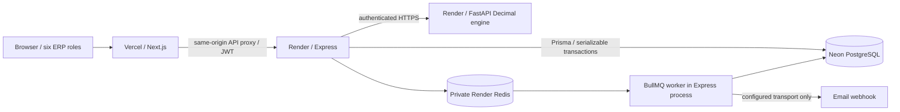
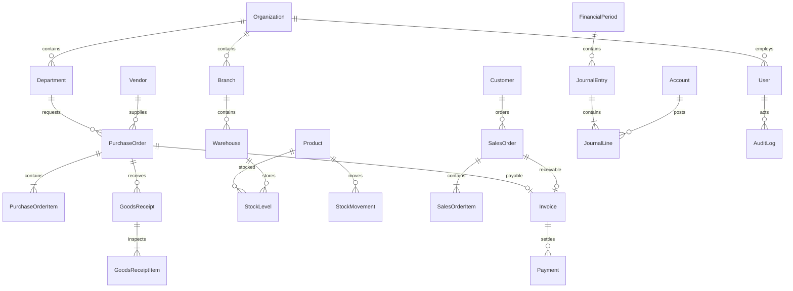

# EnterpriseX architecture and ownership

Express owns users, organization scope, master data, approvals, orders, receipts, stock, invoices, payments, the ledger, audit, incidents and stored PDFs. FastAPI is stateless and owns calculations. Redis is a queue transport; PostgreSQL persists job payload/state and transaction results. Next.js owns presentation and an in-memory query cache, not the ledger.

Additional persisted entities are AuthSession, WorkflowRun, ApprovalRequest, IntegrationJob, StoredDocument, SystemNotification and SystemIncident. The Prisma schema is the complete data dictionary.

The transaction context joins nested domain services and audit writes into one serializable PostgreSQL transaction. Business identifiers use random UUID-derived suffixes rather than count-plus-one. Active AP/AR invoices have partial unique indexes. Requests that race a serializable write retry the complete unit of work. A completed or failed workflow stores a payload fingerprint and actor-bound idempotency key.

Journal balances use normal account signs. Receipt debits inventory 1400 and credits GRNI 2020; AP invoicing clears GRNI, recognizes input tax 1300 and AP 2010. Shipment debits COGS 5010 and credits inventory. AR invoicing debits AR 1200 and credits revenue 4010 and output tax 2030. Settlements clear AP/AR against cash 1010. There is no real bank charging integration.

Migrations use DIRECT_DATABASE_URL. Runtime traffic uses DATABASE_URL with a small connection pool. Keeping these separate prevents PostgreSQL session advisory locks from persisting through a transaction pooler.

Docker uses a private network and persistent volumes. Live free hosting uses public TLS endpoints with service authentication for Express/FastAPI because Render free web services cannot receive private ingress. Redis remains internal. The free worker shares the web-service lifecycle; PostgreSQL allows recovery after a restart.
