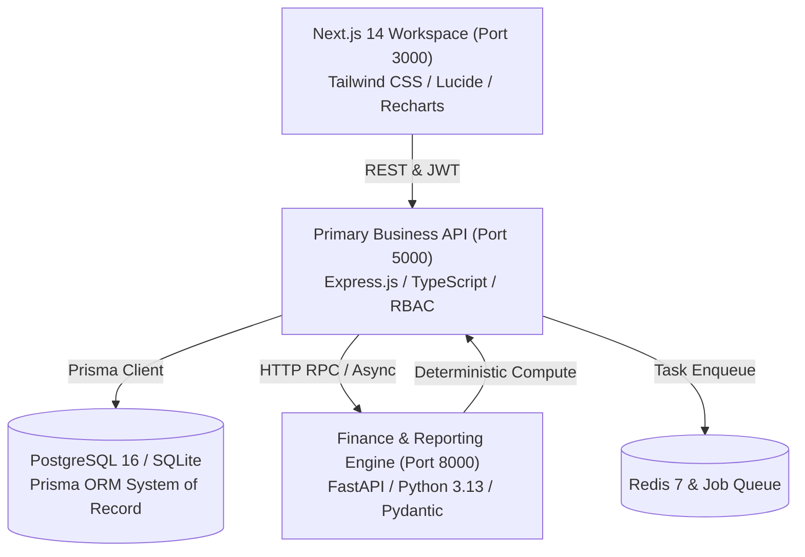
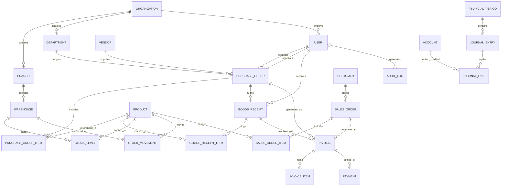

# EnterpriseX Technical Architecture & Data Models

## 1. High-Level Architectural Topology

## 2. Relational Entity-Relationship Diagram

## 3. Data Integrity & Domain Invariants

1. **Double-Entry General Ledger Balance:** Every journal entry requires `sum(debit) == sum(credit) > 0`.
2. **Financial Period Controls:** Closed or locked financial periods reject any journal entry attempt.
3. **Non-Negative Stock:** Physical inventory increments on GRN and decrements on SO fulfillment. Negative levels throw `NEGATIVE_STOCK`.
4. **Idempotency Guardrail:** Payment processing requires an `idempotencyKey` preventing duplicate charges.
5. **3-Way Matching:** Accounts payable invoices verify PO amounts against received GRN quantities.
